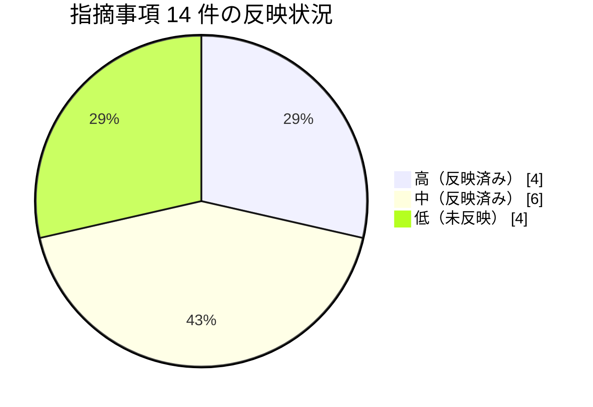

# レビュー記録: AI Software Factory Engineering Standard v1.1 Draft

- 対象: [ai-software-factory-engineering-standard.md](ai-software-factory-engineering-standard.md)
- レビュー日: 2026-11-09
- レビュー方法: 本文の整合性確認、本リポジトリの現状（README・CLAUDE.md・`.claude/settings.json`・[PoC 計画書](../poc/PLAN.md)）との突き合わせ、第 7 章の参照 URL の到達確認

## 総評

AI に任せる範囲を広げる前に、検証できる仕組み・権限・承認ゲートを整えるという方針は一貫しています。公式資料の事実と独自の分類を分ける注記（§4 冒頭、§7 冒頭）もあり、標準文書の骨格として妥当です。

一方で、多くの要件が「〜を設ける」「〜を防ぐ」という方針の記述にとどまっています。既定値（再試行の上限、KPI の定義、高リスク変更の範囲など）がないため、このままでは CI やレビューで準拠しているかを判定できません。§1.1 の原則 1「検証可能な仕組みを重視する」を文書自身にも当てはめ、Draft を外す前に判定できる基準を加えることを勧めます。

## 1. 配置時に反映した修正

| 箇所 | 修正内容 | 理由 |
|---|---|---|
| §7.6 | URL を `https://code.claude.com/docs/en/best-practices` に更新し、旧 URL と旧題を併記 | 旧 URL は 308 で恒久リダイレクトされ、現行の題は「Best practices for Claude Code」 |
| 冒頭 | 本レビュー記録へのリンクを追加 | 未反映の指摘を追えるようにするため |

ほかの本文は受け取った原文のままです。

その後、指摘事項の高優先度 4 件（§3 の 1〜4）を本文に反映しました。

| 指摘 | 反映した箇所 |
|---|---|
| 1. CLAUDE.md と AGENTS.md の正本 | §2.1（整備するもの・標準要件）、§4.1 |
| 2. 再試行・コストの上限 | §2.4 に「再試行の上限（既定値）」を追加、§2.9 |
| 3. 高リスク変更の範囲 | §2.6 に「高リスク変更の範囲」を追加、§2.7 から参照 |
| 4. 設定を緩和させない手段 | §2.6 に「設定を緩和させないための手段」を追加 |

続いて、中優先度の 6 件（§3 の 5〜10）も本文に反映しました。

| 指摘 | 反映した箇所 |
|---|---|
| 5. KPI の定義 | §2.9 の KPI 表に「定義」「測定元」の列と集計期間・対象を追加 |
| 6. アサーション削除の検出 | §2.5 の標準要件に、CI のテスト件数・カバレッジ比較、PR テンプレートのチェック項目、Lint ルールを追加 |
| 7. 本番接続の扱い | §2.3 に「本番環境へ接続する場合の例外条件」（読み取り専用・事前承認・期限・共有設定に残さない）を追加。README の Supabase の記述と整合する形にした |
| 8. 比較検討対象 | §2.4 の候補一覧を削除し、PoC 計画書へのリンクに変更 |
| 9. 標準と作業依頼の分離 | 旧 §6 を [docs/plans/active/ai-software-factory-initial-assessment.md](../plans/active/ai-software-factory-initial-assessment.md) に移し、§6 はリンクだけにした |
| 10. 導入状態の区別 | §2.5・§2.6 の表に「本リポジトリでの状態」列を追加（§2.6 は表形式に変更） |

その後、DB まわりの記述が Supabase に寄っていたため、本文を特定の DB・ホスティングに依存しない書き方に改め、Supabase・Vercel・Cloudflare での具体例を付録 A に分けました（§2.3・§2.5・§2.6・§4）。

§2.4 の再試行回数（CI 修正 3 回など）は、運用実績がないまま置いた初期値です。PoC や運用の結果を見て見直してください。

## 2. 参照資料（第 7 章）の確認結果

| § | 資料 | 結果 |
|---|---|---|
| 7.1 | OpenAI — Harness engineering | **未確認**（openai.com が Cloudflare の bot チャレンジで自動取得を拒否する。HTTP 403、`cf-mitigated: challenge`） |
| 7.2 | Anthropic — Effective harnesses for long-running agents | 確認済み。URL・題・公開日（2025-11-26）が一致 |
| 7.3 | Anthropic — Harness design for long-running application development | 確認済み。URL・題・公開日（2026-03-24）が一致。Planner / Generator / Evaluator 構成と Playwright MCP による評価を扱う |
| 7.4 | OpenAI — Symphony | **未確認**（同上） |
| 7.5 | Anthropic — Effective context engineering for AI agents | 確認済み。URL・題・公開日（2025-09-29）が一致 |
| 7.6 | Claude Code Best practices | リダイレクトを確認し、URL を修正（上表） |
| 7.7 | GitHub Rulesets / Code Security | 確認済み。2 件とも HTTP 200。ページ題は「Available rules for rulesets」と「Security and code quality documentation」（Code Security の入口ページの現行の題） |
| 7.8 | Playwright Test | 確認済み。HTTP 200。ページ題は「Installation」（Playwright Test の導入ページ） |

未確認の 2 件（OpenAI）は自動取得できないため、ブラウザで URL・題・公開日を確かめてから Draft を外してください。

## 3. 指摘事項

優先度: **高** = 標準として運用する前に直したい / **中** = v1.2 で対応したい / **低** = 任意

### 高

1. **【反映済み】CLAUDE.md と AGENTS.md の正本が決まっていない（§2.1、§4.1）**
   §4.1 は「正本を明確にすること」と求めていますが、CLAUDE.md（Claude Code 向けの基本情報）と AGENTS.md（エージェント間で共有する基本規約）の両方に基本規約が書かれる構成になっています。
   改善案: 共通の規約は AGENTS.md を正本とし、CLAUDE.md は `@AGENTS.md` で取り込んだうえで Claude Code 固有の事項だけを書く、と明記する。

2. **【反映済み】再試行・コストの上限に既定値がない（§2.4、§2.9）**
   「上限を設ける」「無限ループを防ぐ」とありますが、数値も、上限に達したときの動作もありません。
   改善案: 既定値を例示する（例: CI 修正は 3 回まで、Issue 当たりのコスト上限、上限到達時は Issue にラベルを付けて人間へエスカレーション）。プロジェクトごとに上書きできる形にする。

3. **【反映済み】「高リスク変更」の範囲が決まっていない（§2.6、§2.7）**
   人間の承認が必要な条件の中心なのに、範囲が書かれていません。
   改善案: 対象パスを列挙し（認証・認可、課金、個人情報、DB マイグレーション、`.github/workflows/`、`.claude/settings.json`、`.mcp.json` など）、CODEOWNERS と Rulesets で強制する。

4. **【反映済み】「AI が CI・セキュリティ設定を無断で緩和できない」の実現手段がない（§2.6）**
   原則 1 に照らすと、文書での指示だけでは足りません。
   改善案: 次の 3 点を要件に加える。
   - 上記の設定ファイルを CODEOWNERS の対象にし、人間のレビューを必須にする。
   - `.claude/settings.json` で、これらのファイルへの Edit / Write を `ask` または `deny` にする。
   - Rulesets で Required Status Checks の迂回（bypass）を管理者に限定する。

### 中

5. **【反映済み】KPI に定義がない（§2.9）**
   分母・分子・測定元・測定期間がないため、比べることができません。例えば「Issue 完遂率」で、人間が途中で手を入れたものを完遂に含めるかが決まっていません。
   改善案: KPI ごとに定義と測定元（GitHub API、Claude Code の使用量ログなど）を書く。「変更起因障害率」は DORA の Change Failure Rate に合わせると外部と比べやすい。

6. **【反映済み】「テストを通すためにアサーションを削除しない」を検出する手段がない（§2.5）**
   改善案: テストの件数やカバレッジの減少を CI で検出して警告する。あわせて、テストファイルの削除・skip 追加をレビュー観点（PR テンプレートのチェック項目）に入れる。

7. **【反映済み】本番接続の扱いが README と食い違う（§2.3）**
   §2.3 は「本番環境の認証情報を開発 Agent へ渡さない」としていますが、本リポジトリの README は「やむを得ず本番 Supabase につなぐ場合は `read_only=true`」と例外を認めています。
   改善案: 例外を認めるなら条件（読み取り専用、承認者、期限）を標準に書く。認めないなら README を標準に合わせる。

8. **【反映済み】§2.4 の比較検討対象が PoC 計画書と一致していない**
   [PoC 計画書](../poc/PLAN.md) には併用検証の対象として Ponytail も含まれ、Feature Dev の表記も異なります。
   改善案: 候補の一覧は PoC 計画書を正本にし、§2.4 からはリンクするだけにする（§4.1 の「正本を明確に」に合わせる）。

9. **【反映済み】標準と作業依頼が同じ文書に入っている（§6）**
   §6 は一度きりの作業依頼で、標準本体とは更新のタイミングが異なります。
   改善案: §6 は GitHub Issue（または `docs/plans/active/`）に移し、標準からはリンクする。

10. **【反映済み】導入済みのものと検討中のものが区別されていない（§2.5、§2.6）**
    Security Guidance と Playwright MCP は本リポジトリで導入済み、Claude Security などは比較検討中、CodeQL・Dependabot・ESLint などは未導入です。§2.6 の「比較検討中」以外は区別がありません。
    改善案: 標準技術の表に「状態（採用済み / PoC 中 / 予定）」の列を加える。

### 低

11. **変更履歴がない** — Version 1.1 とありますが、1.0 からの変更点がわかりません。末尾に変更履歴を設けることを勧めます。
12. **Phase の完了条件が定性的（§5）** — 例えば Phase 2 の「評価用 Issue」の件数・難易度・合格基準を決めておくと判定しやすくなります。PoC 計画書の評価基準（§4）を流用できます。
13. **DB 検証の手段が粗い（§2.5）** — マイグレーションの適用テストに加えて、行レベルのアクセス制御を含む DB の権限をテストで検証することを明記すると、§2.6 の認可の重点検査と結び付きます（想定技術での例は標準文書の付録 A）。
14. **Secret Scanning の push protection（§2.6）** — 検出だけでなく push protection の有効化も要件にすると、Secrets を Git に保存しないという要件を強制できます。

## 4. 本リポジトリの現状との主な差分（参考）

[初回の作業依頼](../plans/active/ai-software-factory-initial-assessment.md)（旧 §6）で求められている詳細なギャップ分析は別作業とし、ここでは配置時に気付いた点だけを挙げます。

| 要素 | 現状 | 評価 |
|---|---|---|
| 1 開発規約 | CLAUDE.md あり。`.claude/rules/`・ARCHITECTURE.md・ADR はなし | 部分充足 |
| 2 要件・タスク管理 | `.github/` がなく、Issue / PR テンプレートもない | 未充足 |
| 5 品質保証 | アプリのコードがまだなく、テストもない（PoC 計画書の Week 1 で作成予定） | 未充足 |
| 6 セキュリティ | Security Guidance を導入済み。`.env` の Read を deny、push・マージを ask にしている。CodeQL・Dependabot はなし | 部分充足 |
| 7 CI/CD | GitHub Actions・CODEOWNERS はなし。Rulesets は未確認 | 未充足 / 未確認 |
| 10 継続的改善 | PoC 計画書と結果テンプレートあり | 部分充足 |
