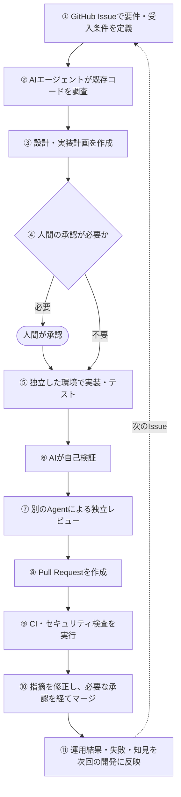
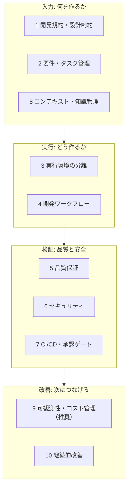
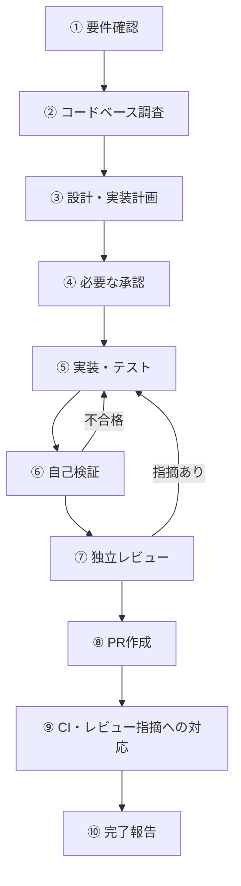
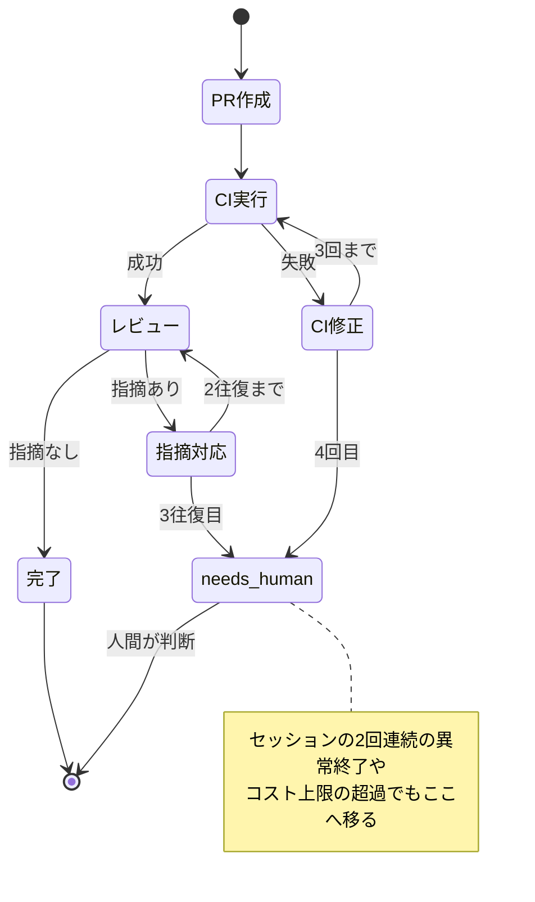
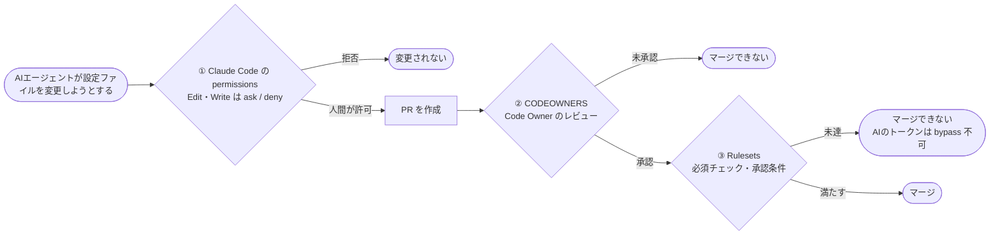
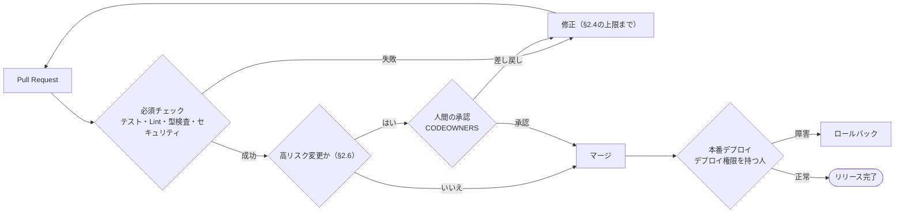
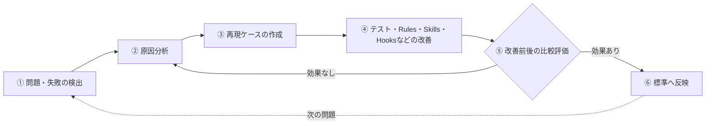
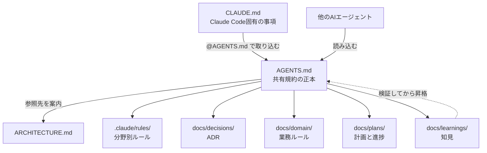
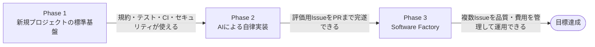
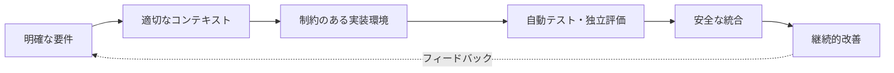

# AI Software Factory Engineering Standard
## AI駆動開発の標準基盤・設計原則・実装要件

**Version:** 1.1 Draft  
**策定日:** 2026-11-09  
**対象:** Claude Codeを中心とした商用ソフトウェア開発  
**想定技術:** Next.js / TypeScript / Supabase / Vercel / Cloudflare / GitHub

本文の要件は、特定の DB・ホスティング・CDN に依存しない書き方にしている。想定技術での具体的な対応は [付録 A](#付録-a-想定技術スタックでの対応例) にまとめる。

> レビュー結果と未反映の指摘事項は [REVIEW.md](REVIEW.md) を参照。

---

# 1. 目的と基本方針

本ドキュメントは、AIエージェントを主体とするソフトウェア開発において、品質・生産性・セキュリティ・保守性を確保するために必要な開発基盤を定義する。

目指すのは、単にClaude CodeへSkillsやPluginsを追加することではない。

**AIエージェントが要件を理解し、設計・実装・検証・レビューを実行し、その成果を安全かつ継続的に本番環境へ届けられる開発システムを構築する。**

特定のAIモデルやSkillsに過度に依存せず、将来的に使用するAIエージェントを変更した場合でも、開発品質を維持できる仕組みを目指す。

## 1.1 基本原則

1. **AIへの指示より、検証可能な仕組みを重視する。** 重要なルールはCIや静的解析で強制する。
2. **必要な情報をAIが発見できるようにする。** 設計・仕様・制約をリポジトリ内で管理する。
3. **実装と評価を分離する。** AIの自己申告だけで品質を判断しない。
4. **作業を再現可能にする。** 環境、タスク、テスト、実行条件を管理する。
5. **失敗を次回の改善につなげる。** テスト・規約・ハーネスを継続的に改善する。
6. **自律性はリスクに応じて拡大する。** 権限と承認ゲートを適切に設計する。
7. **仕組みを複雑化しすぎない。** 導入効果を測定し、不要な工程を削減する。

## 1.2 目指す開発プロセス



この工程を、GitHub Issues・Claude Code・GitHub Actions・Skills・Hooks・MCPなどで構成する。

---

# 2. AI駆動開発に必要な10の基盤要素

以下を新規プロジェクトの標準整備項目とする。



「改善」で得た知見は、規約・テスト・ハーネスの更新として「入力」に戻す（§2.10）。

| # | 領域 | 必要な仕組み | 優先度 |
|---|---|---|---|
| 1 | 開発規約・設計制約 | CLAUDE.md、Rules、ADR、Architecture Tests | 必須 |
| 2 | 要件・タスク管理 | GitHub Issues、受入条件、PRテンプレート | 必須 |
| 3 | 実行環境の分離 | Worktree、独立Session、Sandbox、テストDB | 必須 |
| 4 | 開発ワークフロー | Plan → Implement → Test → Review → PR | 必須 |
| 5 | 品質保証 | Lint、型チェック、単体・結合・E2Eテスト | 必須 |
| 6 | セキュリティ | SAST、SCA、Secret Scanning、最小権限 | 必須 |
| 7 | CI/CD・承認ゲート | GitHub Actions、Rulesets、デプロイ制御 | 必須 |
| 8 | コンテキスト・知識管理 | Architecture、ADR、業務仕様、進捗記録 | 必須 |
| 9 | 可観測性・コスト管理 | Agent実行履歴、品質・費用KPI | 推奨 |
| 10 | 継続的改善 | Evals、失敗分析、Rules・Skillsの改善 | 必須 |

## 2.1 開発規約・アーキテクチャ制約

**目的：** AIがプロジェクト固有の設計原則を理解し、既存アーキテクチャに沿って実装できるようにする。

**整備するもの**
- `AGENTS.md`：エージェントの種類を問わず共有する基本規約の正本
- `CLAUDE.md`：`@AGENTS.md` による取り込みと、Claude Code 固有の事項（主要コマンド、ドキュメントへの案内など）
- `.claude/rules/`：DB、API、セキュリティ、テストなどの分野別ルール
- `ARCHITECTURE.md`：システム構成、コンポーネント、依存関係
- `docs/decisions/`：重要な設計判断を記録するADR
- アーキテクチャ制約を検証するLint・静的解析

**標準要件**
- `CLAUDE.md`を巨大な規約集にしない。
- 共通の規約は`AGENTS.md`を正本とし、`CLAUDE.md`は冒頭で`@AGENTS.md`を取り込んだうえで Claude Code 固有の事項だけを書く。同じ規約を両方に書かない。
- 重要な制約はドキュメントだけでなくコードで検証する。
- 禁止事項と推奨事項を区別する。
- 既存の適切な設計を優先し、不要な独自実装を避ける。
- 規約の変更もコードレビューの対象とする。

**規約の書き方**

各プロジェクトの `AGENTS.md` は、雛形（[templates/agents/AGENTS.md](../../templates/agents/AGENTS.md)）から始める。雛形の「規約」の節が共通の規約で、各プロジェクトは「このプロジェクトの罠」の節を次の書き方で埋める。

- 罠は、理由とセットで書く。ここでいう罠とは、コードを見ただけでは意図が分からず、AI が「整理」のつもりで壊しやすいものを指す。例: わざと残しているスタブ、他システムが読む古い列、業務上の決まりによる例外。
  - 規約の行は言い切りの形（「〜する」）で書き、理由はその下の別の行に 1 文で書く。
  - 過去に起きた事象（不具合、障害、レビューでの指摘）から生まれた罠には、その記録（Issue・PR・障害報告）へのリンクを理由に添える。
    - 規約を消してよいかを、人も AI も記録をたどって判断できるようにするため。
    - 原因になった仕組みがなくなったときに、規約が古くなったと気づけるようにするため。
  - 書き方の例:
    ```markdown
    - 出荷済みのマイグレーションは書き換えず、末尾に新しい番号で追加する。
      - 理由: 本番の DB はすでに古い番号まで適用済みで、書き換えても再実行されないため（#123 で、書き換えた列が本番に反映されなかった）。
    ```
- 条件つきの形（「〜する場合は〜する」「〜したら〜する」）は避け、言い切りの形に直す。
- 禁止の形（「〜してはいけない」）は、やるべきことを言い切りの形で書けないかを先に考える。
- 汎用の心得（「テストを書く」「丁寧に設計する」など）は足さない。指示ファイルには、そのプロジェクト固有の罠と決まりだけを書く。
- 規約の正本は既存のコードに置き、文書からはお手本のコードを指す。`AGENTS.md` には「ドキュメントと既存のコードが食い違うときは、既存のコードの書き方に従い、見つけた食い違いを最後の返答ですべて挙げる」の一文を入れる。

根拠（2026-11-10 時点）:

- 罠と理由をセットで書く形は、有名 OSS の指示ファイルに共通して見られた。dbt-core は禁止事項に必ず「Why」を添え、transformers や goose は体験から来た罠を理由つきで並べている（30 リポジトリの調査）。
  - 理由があると、その規約を消したり簡略化したりしてよいかを AI が判断できる。この点は推論で、比較実験はまだない。
  - 事象と紐づける形も、調査した OSS にあった。goose は体験から来た罠を並べ、vscode は直前の失敗から教訓を作って指示ファイルに追記する仕組みを持つ。
- 理由を同じ文に続ける書き方（「〜する。〜のためです」）を、言い切りの規約と比べた実験がある。守られる割合は、Opus 5 では変わらず（78.0% と 77.2%）、Sonnet 5 では下がった（71.6% から 49.4%）。条件つきの形は、調べたすべての組み合わせで守られにくかった（[arXiv:2611.04367](https://arxiv.org/abs/2611.04367)）。
  - 上の書き方で、理由を別の行に分けているのはこのため。ただし、別の行に分ける書き方の効果は、この実験では測られていない。
- 汎用の開発標準（23 項目）を指示ファイルに足した PoC の条件では、品質の差が平均 +0.1 点で、試行ごとのばらつきと同じ大きさだった（[PoC W12](../poc/results/workflow/W12/report.md)）。
- エージェントは、指示ファイルに書かれた古い説明を、目の前のコードより優先しやすい。食い違いの扱いを定めた一文を足すと、コードに従う割合が 4.2% から 91.4% に上がった（[arXiv:2610.30571](https://arxiv.org/abs/2610.30571)）。この実験では、一文を利用者ごとの指示ファイル（`~/.claude/CLAUDE.md`）に置いていた。

## 2.2 要件・タスク管理

**目的：** AIが何を実装すべきか、どの条件を満たせば完了なのかを明確にする。

**整備するもの**
- GitHub Issue Template
- Pull Request Template
- 受入条件（Acceptance Criteria）
- Definition of Done
- タスク間の依存関係

**標準要件**

Issueには最低限、以下を記載する。

- 背景と目的
- 対象範囲・対象外範囲
- 受入条件
- 技術的・業務的な制約
- テスト観点
- 関連する設計資料

仕様が曖昧な場合は、実装前に確認または明示的な仮定を置く。

## 2.3 実行環境と作業の分離

**目的：** 複数のAIエージェントが安全に並列作業できるようにする。

**整備するもの**
- Git Worktree
- 独立したAgent Session
- 再現可能な開発環境
- 開発用・テスト用DB
- Secrets管理
- サンドボックス

**標準要件**
- Issue単位で作業ブランチ・セッションを分離する。
- 並列作業ではWorktreeを分離する。
- 本番環境の認証情報を開発Agentへ渡さない。例外は下記の条件をすべて満たす場合に限る。
- DB変更は隔離された開発環境で検証する。
- 作業環境を再作成できるようにする。

**本番環境へ接続する場合の例外条件**

障害調査などでやむを得ず開発Agentを本番環境へ接続する場合は、以下をすべて満たすこと。

1. **読み取り専用：** 書き込みできない接続方法に限る（例: DB の読み取り専用ロールを使う、MCP サーバーやCLIの読み取り専用モードを使う）。
2. **事前承認：** 目的・接続先・期間を Issue に書き、本番環境の管理者が承認する。
3. **期限：** 作業が終わったら、または承認した期限が来たら接続設定を外し、使った認証情報を失効させる。
4. **共有設定に残さない：** 接続設定は`.claude/settings.local.json`などの個人設定に置き、`.mcp.json`や`.claude/settings.json`にはコミットしない。

Worktreeはコードの作業領域を分離するものであり、セキュリティ上のサンドボックスではない。必要に応じてコンテナや権限制御を組み合わせる。

## 2.4 開発ワークフロー・オーケストレーション

**目的：** 要件から実装・検証・PR作成までを再現可能な手順で実行する。

**標準ワークフロー**



**標準要件**
- 各工程の完了条件を定義する。
- 作業状態をGitHub上で追跡できるようにする。
- 失敗時の再試行条件と上限を設ける（既定値は下表）。
- 無限の修正ループを防ぐ。
- セッション間で作業状態を引き継げるようにする。

**再試行の上限（既定値）**

プロジェクトごとに上書きしてよい。上書きした値は`AGENTS.md`に書く。

| 対象 | 上限 | 上限に達したとき |
|---|---|---|
| 同じ CI 失敗の修正 | 3 回 | 修正を止め、原因の調査結果を Issue に書いて人間へ引き継ぐ |
| 同じレビュー指摘への対応 | 2 往復 | 対応方針を人間に確認する |
| セッションの異常終了・タイムアウト | 2 回連続 | 再開を止め、失敗の原因を記録して人間へ引き継ぐ |
| Issue 当たりのコスト | §2.9 の上限 | 作業を止めて人間へ引き継ぐ |



人間へ引き継ぐときは、Issue に`needs-human`ラベルを付け、それまでの経過・試したこと・判断が必要な点をコメントに残す。

**比較検討対象**

候補の一覧・評価基準・判定結果は [PoC 計画書](../poc/PLAN.md) を正本とし、ここには重ねて書かない。

主軸となる開発ワークフローは原則1つとし、役割の重複を避ける。

## 2.5 自動テスト・品質保証

**目的：** AIによる実装結果を、客観的・再現可能な方法で検証する。

「本リポジトリでの状態」は 2026-11-09 時点。採用済み = 導入して使っている / PoC 中 = [PoC 計画書](../poc/PLAN.md) で比較している / 予定 = 標準として採用する予定だが未導入。

| 検査 | 標準技術案 | 本リポジトリでの状態 |
|---|---|---|
| 型検査 | TypeScript | 予定（TypeScript LSP Plugin は採用済み） |
| Lint | ESLint | 予定 |
| フォーマット | Prettier | 予定 |
| 単体テスト | Vitest | 予定 |
| 結合テスト | Vitest + Test DB | 予定 |
| E2E | Playwright Test | 予定 |
| UI操作・調査 | Playwright MCP | 採用済み |
| DB検証 | 利用する DB のマイグレーション・テストツール（付録 A） | 予定 |
| CI | GitHub Actions | 予定 |

**標準要件**
- 受入条件に対応するテストを用意する。
- テストの成功をAgentの自己申告だけで判断しない。
- CIでテストを再実行する。
- 障害修正には回帰テストを追加する。
- テストを通すために機能やアサーションを削除しない。これを次の手段で検出する。
  - CI でテスト件数とカバレッジを基準ブランチと比べ、減っていれば警告する。
  - PR テンプレートに「テストの削除・`skip`・`only`の追加、アサーションの削除・緩和がある場合は理由を書く」チェック項目を入れる。
  - `.skip`・`.only`の追加を Lint で検出する（例: `@vitest/eslint-plugin`の`no-disabled-tests`・`no-focused-tests`、`eslint-plugin-playwright`の`no-skipped-test`・`no-focused-test`）。
  - テストファイルの削除は CODEOWNERS の対象にしたテストディレクトリへの変更として、人間のレビューで確認する。
- 高リスク変更では独立した評価を実施する。

Playwright MCPによるブラウザ操作と、Playwright Testによる自動E2Eテストは役割を区別する。

失敗を検査に反映するとき（どの段に置くか、不安定なテストの扱い、CI の絞り込み）は、[失敗を検査に反映するときの方針](testing-and-ci-policy.md) に従う。

## 2.6 セキュリティと権限制御

**目的：** AIが生成するコードと、AIエージェント自身の操作を安全に管理する。

**整備するもの**
- SAST（静的アプリケーションセキュリティテスト）
- SCA（依存関係の脆弱性検査）
- Secret Scanning
- 最小権限のアクセス制御
- セキュリティレビュー
- 開発環境の隔離

**標準ツール案**

状態の意味は§2.5と同じ。

| ツール | 役割 | 本リポジトリでの状態 |
|---|---|---|
| GitHub CodeQL | SAST | 予定 |
| Dependabot | SCA | 予定 |
| GitHub Secret Scanning | Secret Scanning | 予定 |
| Anthropic Security Guidance | 実装中のセキュリティ指摘 | 採用済み |
| Claude Security | セキュリティ監査 | PoC 中 |
| Cloudflare Security Audit | セキュリティ監査 | PoC 中 |

**標準要件**
- Agentへ必要最小限の権限を付与する。
- 本番DBへの直接書き込みを原則禁止する。
- SecretsをGitや実行ログへ保存しない。
- 認証・認可・個人情報・課金関連の変更を重点検査する。
- AIがCIやセキュリティ設定を無断で緩和できないようにする（実現手段は下記）。
- AIレビューと静的解析を独立した検査として扱う。

**高リスク変更の範囲**

以下に当てはまる変更を高リスク変更とし、人間の承認を必須にする（§2.7）。対象パスはプロジェクトの構成に合わせて`CODEOWNERS`に列挙し、承認を強制する。

| 区分 | 対象の例 |
|---|---|
| 認証・認可 | ログイン・セッション・権限判定のコード、DB の行レベルのアクセス制御（RLS など）の定義 |
| 個人情報 | 個人情報を保存・表示・送信するコード、ログ出力の設定 |
| 課金 | 決済・請求・料金計算のコード |
| DB スキーマ | マイグレーションファイル（例: `db/migrations/`） |
| CI・品質ゲート | `.github/workflows/`、`.github/CODEOWNERS`、`.github/dependabot.yml`、Lint・テストの設定ファイル |
| エージェントの権限 | `.claude/settings.json`、`.mcp.json`、`AGENTS.md`、`CLAUDE.md`、`.claude/rules/` |
| インフラ・デプロイ | 環境変数の定義、ホスティング・CDN・DB などの外部サービスの設定 |

**設定を緩和させないための手段**

文書での指示だけに頼らず、以下の 3 つを組み合わせて強制する。



1. **CODEOWNERS：** 上表の「CI・品質ゲート」と「エージェントの権限」のパスを CODEOWNERS の対象にし、Rulesets で「Require review from Code Owners」を有効にする。
2. **Claude Code の permissions：** `.claude/settings.json`で、これらのファイルへの`Edit`・`Write`を`ask`（または`deny`）にする。
3. **Rulesets の bypass 制限：** Required Status Checks と承認条件を迂回できる主体（bypass list）を管理者に限定し、AIエージェントが使うトークンや GitHub App を含めない。

## 2.7 CI/CDと承認ゲート

**目的：** 品質条件を満たさない変更が本番環境へ反映されることを防ぐ。

**整備するもの**
- GitHub Actions
- Branch Rulesets
- Required Status Checks
- CODEOWNERS
- 環境別デプロイ権限
- ロールバック手順

**標準要件**
- 原則としてPull Request経由で変更する。
- テスト・Lint・型検査を必須の品質ゲートにする。
- セキュリティ検査をCIに組み込む。
- 高リスク変更（範囲は§2.6）は人間の承認を必要とする。
- マージ権限と本番デプロイ権限を適切に分離する。
- ロールバック手段を用意する。



すべての変更に一律の承認を要求するのではなく、リスクに応じた承認ゲートを設計する。

## 2.8 コンテキスト・知識管理

**目的：** Agentやセッションが変わっても、正しい設計思想と作業状況を引き継げるようにする。

**管理する情報**
- システムアーキテクチャ
- 業務仕様
- ADR
- API仕様
- DBスキーマ
- 過去の重要な障害
- 実装計画
- 進捗と引き継ぎ情報

**標準要件**
- リポジトリ内のドキュメントを主要な知識源とする。
- `CLAUDE.md`に大量の情報を直接記載しない。
- 重要な設計判断は履歴を残す。
- 長期間の作業では進捗を明示的に記録する。
- 古い情報を更新し、重複した知識を整理する。
- 蓄積した知見を無条件で規約に昇格させない。

## 2.9 可観測性・実行履歴・コスト管理

**目的：** AI開発の品質・生産性・費用を継続的に把握する。

**収集する情報**
- IssueとAgent Sessionの対応関係
- モデル・Subagentの実行履歴
- 実行時間
- トークン使用量
- API料金換算額
- 人間の介入回数と作業時間
- CI結果
- エラー・再試行回数

**主要KPI**

集計期間は原則として月単位とし、対象は AI エージェントに割り当てた Issue（`agent`ラベルなどで識別する）に限る。

| KPI | 目的 | 定義 | 測定元 |
|---|---|---|---|
| Issue完遂率 | AIがPRまで完遂できた割合 | AI が作成した PR がマージされた Issue 数 ÷ AI に割り当てた Issue 数。人間がコードを書き足した PR も完遂に含めるが、人間介入時間に計上する | GitHub（Issue・PR・ラベル） |
| CI初回合格率 | 初期実装の品質 | 最初の push で必須チェックがすべて成功した PR 数 ÷ AI が作成した PR 数 | GitHub Actions のチェック結果 |
| 平均修正回数 | 修正ループの効率 | PR 作成後に CI 失敗またはレビュー指摘への対応で行った push 回数の平均 | GitHub（PR のコミット・チェック履歴） |
| 人間介入時間 | 自律化の効果 | Issue 1 件当たりに人間が使った時間（要件の補足、承認、レビュー、引き継ぎ後の作業）の合計 | 作業記録（Issue のコメントまたは自己申告） |
| Issue当たりAIコスト | 費用対効果 | Issue に紐づく全セッションのトークン使用量を API 料金に換算した合計 | Claude Code の使用量記録（OpenTelemetry など） |
| 変更起因障害率 | リリース後の品質 | 本番デプロイのうち、障害・ロールバック・緊急修正が必要になった割合（DORA の Change Failure Rate と同じ定義） | デプロイ履歴と障害記録 |

**標準要件**
- Issue単位で成果物と実行履歴を追跡する。
- セッション失敗時の原因を記録する。
- コスト上限と再試行上限を設定する。再試行上限の既定値は§2.4に従う。Issue 当たりのコスト上限はプロジェクトごとに金額を決めて`AGENTS.md`に書き、決まっていない場合は着手前に人間が決める。
- ログへの機密情報混入を防止する。
- 品質と費用を合わせて評価する。

## 2.10 継続的改善と評価（Evals）

**目的：** AIによる開発の失敗を、開発環境自体の改善へつなげる。

**標準改善ループ**



**標準要件**
- 繰り返し発生する問題を記録する。
- 問題の再発防止テストを作成する。
- RulesやSkillsの変更を検証する。
- 新しいAIモデルやPluginの導入効果を測定する。
- 不要な制約や複雑なワークフローを定期的に削減する。
- 再発防止の検査は、検出できる一番手前の段（型・Lint・単体テスト…）に置く。詳細は [失敗を検査に反映するときの方針](testing-and-ci-policy.md)。

---

# 3. 横断的に適用する設計原則

10の基盤要素に加え、以下の4つを横断原則として扱う。

## 3.1 Harness Engineering

モデル単体ではなく、モデル・ツール・実行環境・指示・評価・フィードバックを一体として設計する。

- モデルの変更だけでなく、ハーネスの改善を重視する。
- Agent・Skills・Hooks・MCPの責務を明確にする。
- 過剰な複雑化を避ける。
- 変更効果を実測で評価する。

## 3.2 Agent Legibility

AIがコード・業務仕様・設計・依存関係を発見し、理解しやすいリポジトリを目指す。

- 暗黙知を減らす。
- 関連資料へ辿れる構造にする。
- API契約・データモデル・依存関係を明示する。
- アーキテクチャ制約を機械的に検証する。

## 3.3 Independent Evaluation

実装Agentの自己評価だけに依存せず、独立した検証手段を利用する。

- 実装とレビューのコンテキストを可能な限り分離する。
- 受入条件を事前に定義する。
- テストと実際のアプリケーション操作で評価する。
- レビューAgentの出力も無条件には信用しない。
- 追加レビューの効果を測定する。

## 3.4 Context Engineering

必要な情報を、必要なタイミングでAgentへ渡す。

- 常時読み込む情報は最小限にする。
- 詳細資料は必要時に参照する。
- セッション間の進捗と状態を保存する。
- 会話履歴だけに作業状態を依存させない。

---

# 4. 推奨リポジトリ構成

以下は本プロジェクト向けの構成案であり、特定企業がそのまま指定する公式標準ではない。

```text
project/
├── README.md
├── CLAUDE.md
├── AGENTS.md
├── ARCHITECTURE.md
│
├── .claude/
│   ├── settings.json
│   ├── rules/
│   │   ├── architecture.md
│   │   ├── database.md
│   │   ├── security.md
│   │   └── testing.md
│   ├── agents/
│   └── skills/
│
├── .github/
│   ├── ISSUE_TEMPLATE/
│   ├── PULL_REQUEST_TEMPLATE.md
│   ├── CODEOWNERS
│   ├── dependabot.yml
│   └── workflows/
│       ├── ci.yml
│       ├── e2e.yml
│       └── security.yml
│
├── docs/
│   ├── architecture/
│   ├── decisions/
│   ├── domain/
│   ├── product-specs/
│   ├── security/
│   ├── operations/
│   ├── plans/
│   │   ├── active/
│   │   └── completed/
│   └── learnings/
│
├── tests/
│   ├── unit/
│   ├── integration/
│   └── e2e/
│
├── db/                  # DB のディレクトリ名は採用する DB のツールに合わせる（付録 A）
│   ├── migrations/
│   └── tests/
│
└── .devcontainer/
```

## 4.1 主要ドキュメントの責務



| ファイル | 責務 |
|---|---|
| README.md | プロジェクト概要・開発環境の準備 |
| CLAUDE.md | `@AGENTS.md`の取り込みと、Claude Code固有の事項 |
| AGENTS.md | エージェント間で共有する基本規約の正本 |
| ARCHITECTURE.md | システム全体の構造 |
| docs/decisions/ | ADR・重要な設計判断 |
| docs/domain/ | 業務ルールと用語 |
| docs/plans/ | 実装計画と進捗 |
| docs/learnings/ | 開発で得た再利用可能な知見 |

同じルールを複数ファイルへ重複して記載せず、正本を明確にすること。

---

# 5. 段階的な導入計画



## Phase 1：新規プロジェクトの標準基盤

**目的：AI駆動開発を安全に開始できる状態を整える。**

整備対象：

- CLAUDE.md・Rules
- アーキテクチャ資料
- Issue・PRテンプレート
- Lint・型検査・テスト
- GitHub Actions
- Branch Rulesets
- セキュリティ検査
- DBマイグレーション管理
- 環境変数・Secrets管理

**完了条件：** 新規プロジェクト作成時点で、開発規約・テスト・CI・セキュリティの基盤が利用できること。

## Phase 2：AIによる自律実装

**目的：Issue単位のAI開発を安定して実行する。**

整備対象：

- 開発ワークフロー選定
- Worktree・Session分離
- 作業状態の記録・引き継ぎ
- 独立したコードレビュー
- CI失敗時の修正ループ
- 実行回数・費用の制限
- 失敗時のエスカレーション

**完了条件：** 評価用IssueをAIが実装・テスト・PR作成まで完遂できること。

## Phase 3：Software Factory

**目的：複数Issueの継続的・並列的な自律開発を成立させる。**

整備対象：

- Issueキューとオーケストレーション
- タスク間の依存関係管理
- 並列実行数の制御
- 自動的な再試行・復旧
- 品質・費用KPIの計測
- 開発知見の蓄積
- ハーネスの継続的評価
- リスクに応じた承認・デプロイ

**完了条件：** 複数Issueの自律開発を、品質・セキュリティ・費用を管理しながら運用できること。

---

# 6. 初回の現状調査（作業依頼）

本ドキュメントを受け取ったClaude Codeへの初回の作業依頼（現状調査・ギャップ分析・提出成果物・実施上の制約）は、標準本体とは更新のタイミングが異なるため、[docs/plans/active/ai-software-factory-initial-assessment.md](../plans/active/ai-software-factory-initial-assessment.md) に分けて管理する。

---

# 7. 公式資料による裏付け

本章では、上記の設計原則を策定する際に参考とした、Anthropic・OpenAI・GitHub等の公式資料を整理する。

**注意：** 本ドキュメントの10要素は複数の資料を基に整理した独自の分類であり、AnthropicやOpenAIが同一の「10要素」を公式に定義しているわけではない。

各資料と10要素の対応は次のとおり（●＝対応する）。

| 資料 | 1 規約 | 2 要件 | 3 環境 | 4 WF | 5 品質 | 6 セキュリティ | 7 CI/CD | 8 知識 | 9 可観測性 | 10 改善 |
|---|---|---|---|---|---|---|---|---|---|---|
| 7.1 OpenAI Harness Engineering | ● | | | | ● | | ● | ● | | ● |
| 7.2 Anthropic Long-Running Agents | | | ● | ● | | | | ● | | ● |
| 7.3 Anthropic Harness Design | | ● | | ● | ● | | | | | ● |
| 7.4 OpenAI Symphony | | ● | ● | ● | | | | | ● | |
| 7.5 Anthropic Context Engineering | ● | | | | | | | ● | | |
| 7.6 Claude Code Best Practices | ● | | | ● | ● | | | ● | | |
| 7.7 GitHub Rulesets / Code Security | | | | | | ● | ● | | | |
| 7.8 Playwright | | | | | ● | | | | | |

## 7.1 OpenAI — Harness Engineering

**資料：** Harness engineering: leveraging Codex in an agent-first world  
**公開日：** 2026-02-11  
**URL：** https://openai.com/index/harness-engineering/

OpenAIは、AIエージェントを主体とする開発の実践として、リポジトリの理解しやすさ、機械的なアーキテクチャ制約、AIによる実動作検証、継続的な改善を紹介している。

特に、`AGENTS.md`を巨大なマニュアルにせず、リポジトリ内のドキュメントへ案内する設計が参考になる。

**対応する要素：** 1、5、7、8、10

## 7.2 Anthropic — Effective Harnesses for Long-Running Agents

**資料：** Effective harnesses for long-running agents  
**公開日：** 2025-11-26  
**URL：** https://www.anthropic.com/research/effective-harnesses-for-long-running-agents

長時間のAI開発において、初期環境の構築、機能単位の実装、進捗記録、Git履歴を使った状態の引き継ぎが重要であることを示している。

**対応する要素：** 3、4、8、10

## 7.3 Anthropic — Harness Design for Long-Running Application Development

**資料：** Harness design for long-running application development  
**公開日：** 2026-03-24  
**URL：** https://www.anthropic.com/research/harness-design-long-running-apps

Planner、Generator、Evaluatorを分離したアプローチを検証している。

実装Agentと評価Agentの分離、実際のアプリケーション操作による品質確認、評価結果を利用した改善が参考になる。

**対応する要素：** 2、4、5、10

## 7.4 OpenAI — Symphony

**資料：** An open-source spec for Codex orchestration: Symphony  
**公開日：** 2026-04-27  
**URL：** https://openai.com/index/open-source-codex-orchestration-symphony/

タスク管理システムを起点とした、AIエージェントの作業割当、実行管理、状態追跡、失敗時の復旧などを扱う。

**対応する要素：** 2、3、4、9

## 7.5 Anthropic — Context Engineering

**資料：** Effective context engineering for AI agents  
**公開日：** 2025-09-29  
**URL：** https://www.anthropic.com/research/effective-context-engineering-for-ai-agents

モデルへ渡す情報の選択、ツール定義、実行履歴、長時間タスクにおけるコンテキスト管理の重要性を説明している。

**対応する要素：** 1、8

## 7.6 Anthropic — Claude Code Best Practices

**資料：** Best practices for Claude Code（旧題: Claude Code: Best practices for agentic coding）  
**URL：** https://code.claude.com/docs/en/best-practices （旧 URL `https://www.anthropic.com/engineering/claude-code-best-practices` はここへ恒久リダイレクトされる）

Claude Codeの実用的な運用方法として、検証手段の提供、コンテキスト管理、作業の分割などを扱う。

**対応する要素：** 1、4、5、8

## 7.7 GitHub — Rulesets / Code Security

**資料：** Available rules for rulesets  
https://docs.github.com/en/repositories/configuring-branches-and-merges-in-your-repository/managing-rulesets/available-rules-for-rulesets

**資料：** GitHub Code Security  
https://docs.github.com/en/code-security

PR承認条件、必須CIチェック、セキュリティ検査などをGitHub上で管理・強制するための公式機能。

**対応する要素：** 6、7

## 7.8 Microsoft — Playwright

**資料：** Playwright Test  
https://playwright.dev/docs/intro

ブラウザ上で実際のアプリケーション動作を検証するための公式テストフレームワーク。

**対応する要素：** 5

---

# 8. 最終方針

AI駆動開発の品質は、モデルの性能や導入したSkillsの数だけでは決まらない。

重要なのは、以下の仕組みを一体として整備することである。



AnthropicやOpenAIの公開事例を参考にしながら、公式資料で確認できる原則と、自社の具体的な技術選定・運用方針を区別して整備する。

**最終目標は、特定のAIツールを標準化することではなく、AIツールが変わっても品質・生産性・セキュリティを維持・改善できる開発基盤を構築することである。**

---

# 付録 A. 想定技術スタックでの対応例

本文の要件を、想定技術（Next.js / TypeScript / Supabase / Vercel / Cloudflare / GitHub）で実現する場合の例。別の技術を採用するプロジェクトでは、同じ要件を満たす手段に置き換える。

| 本文の要件 | 汎用的な手段 | 想定技術での例 |
|---|---|---|
| DB マイグレーション管理（§5 Phase 1） | マイグレーションファイルをリポジトリで管理する | Supabase CLI（`supabase/migrations/`）。§4 の`db/`は`supabase/`に読み替える |
| DB 検証（§2.5） | マイグレーションの適用テスト、権限のテスト | `supabase db reset`による適用確認、`supabase test db`（pgTAP） |
| 行レベルのアクセス制御（§2.6） | DB またはアプリ層で行単位の認可を定義し、テストする | Supabase の RLS ポリシー |
| 本番接続の読み取り専用（§2.3） | 読み取り専用ロール・読み取り専用モード | Supabase MCP の URL に`read_only=true`を付ける |
| 開発用 DB の分離（§2.3） | 開発・テスト専用の DB を用意する | Supabase の開発用プロジェクト、または`supabase start`によるローカル環境 |
| 外部サービスの設定（§2.6 高リスク変更） | ホスティング・CDN・DB の設定を変更管理する | Vercel・Cloudflare・Supabase のプロジェクト設定 |

